# Northstar · AI Agent Workspace

A multi-tenant workspace where teams run AI agents on their own business documents and datasets. In a run, the agent:

- writes a plan;
- searches the uploaded documents;
- analyzes CSV data with safe, predefined operations;
- asks a person for approval before it changes anything;
- answers with citations that can be checked against the source.

Every step, tool call, source, and decision is stored and shown live.

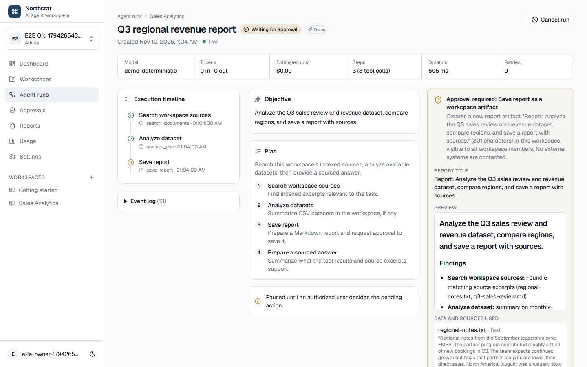

## Contents

- [Key features](#key-features)
- [Screenshots](#screenshots)
- [Technology stack](#technology-stack)
- [Architecture](#architecture)
- [Agent execution lifecycle](#agent-execution-lifecycle)
- [Tool registry](#tool-registry)
- [Human-in-the-loop approval](#human-in-the-loop-approval)
- [Evidence and citations](#evidence-and-citations)
- [Data model](#data-model)
- [Security model](#security-model)
- [Background worker](#background-worker)
- [Document ingestion](#document-ingestion)
- [Real-time updates](#real-time-updates)
- [Usage and observability](#usage-and-observability)
- [Local setup](#local-setup)
- [Configuration](#configuration)
- [Demo data](#demo-data)
- [Testing](#testing)
- [Deployment](#deployment)
- [API](#api)
- [Architecture decisions and trade-offs](#architecture-decisions-and-trade-offs)
- [Known limitations](#known-limitations)

## Key features

- **Organizations, workspaces, and roles.** Admins manage the organization and its workspaces. Members run agents and decide on their own runs. Viewers have read-only access. Roles are enforced in the API and in Postgres RLS.
- **Knowledge base.** PDF, DOCX, TXT, Markdown, and CSV uploads are validated on the server and stored in private storage. A background worker extracts and chunks them, keeping the page, section, or row range of each chunk. Chunks are embedded with pgvector, and CSV rows are stored for analysis.
- **Agent runs.**
  - Structured plans and a bounded tool loop (steps, duration, tokens, estimated cost, retries).
  - Typed tools: `search_documents`, `analyze_csv`, `calculate`, `save_report`.
  - Every model output is validated with Zod.
  - Runs can be cancelled at any time and survive worker crashes.
- **Human-in-the-loop.** Saving a report pauses the run. The approval request shows the action, a preview, the sources used, and the expected effect. Decisions are authorized, applied at most once, audit-logged, and returned to the agent.
- **Evidence.** A citation is accepted only if it points at an excerpt retrieved in the same run and quotes it verbatim. Answers without support are replaced by an explicit "could not verify".
- **Live UI.** Supabase Realtime pushes run events and document status, filtered by RLS. The UI handles duplicates, ordering, gaps, and reconnects.
- **Observability.** A usage page (tokens, estimated cost, tool latency, failures), worker heartbeats, queue status, and structured logs with correlation IDs.
- **Demo mode.** A deterministic demo provider and a seed script make the app explorable without a paid API key. Demo output is always labelled as such.

## Screenshots

| | |
| --- | --- |
| 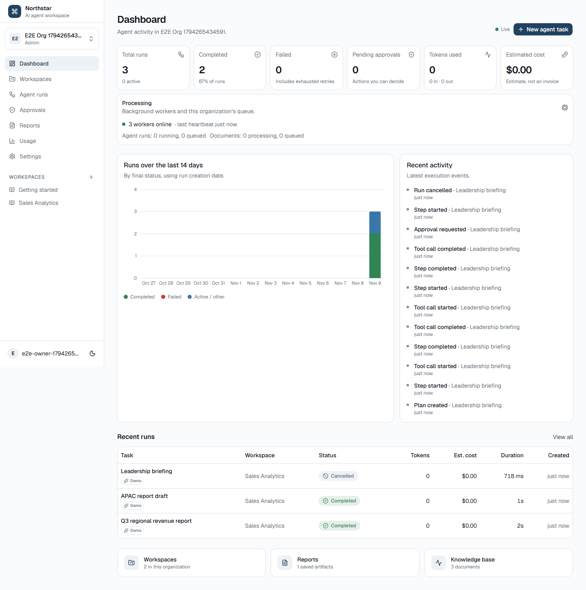 **Dashboard** with live totals, queue status, and recent activity | 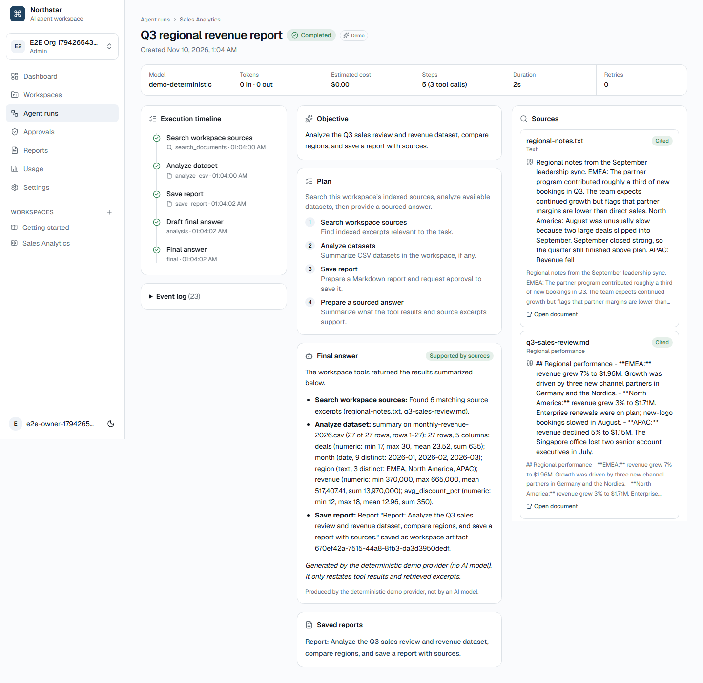 **Completed run**: timeline, plan, sourced answer, cited excerpts |
| 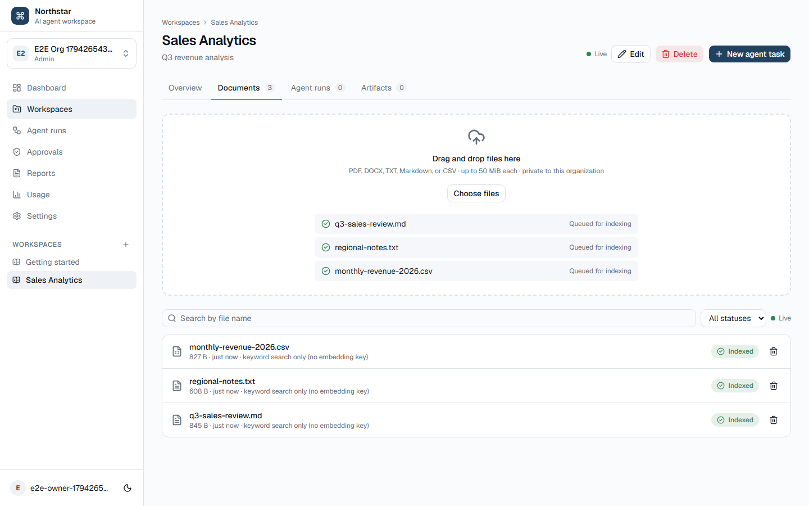 **Knowledge base**: uploads indexed live | 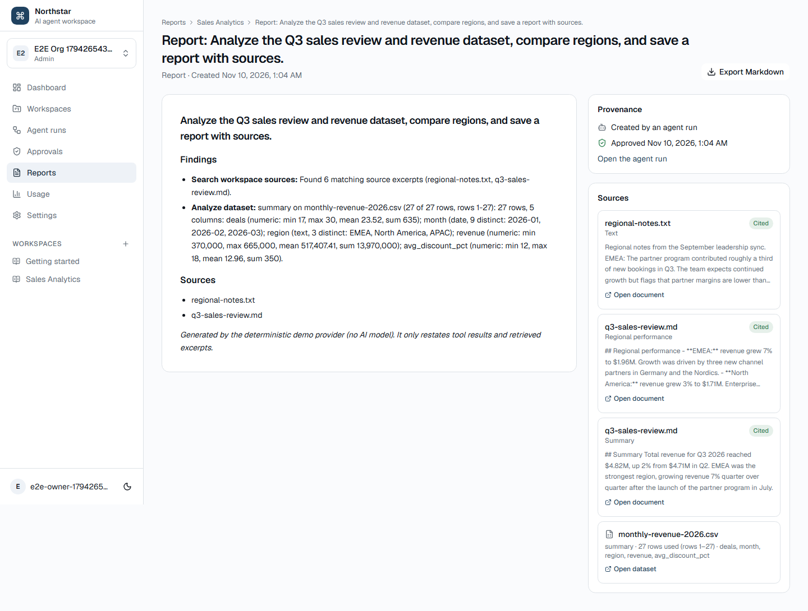 **Approved report** with provenance and sources |
| 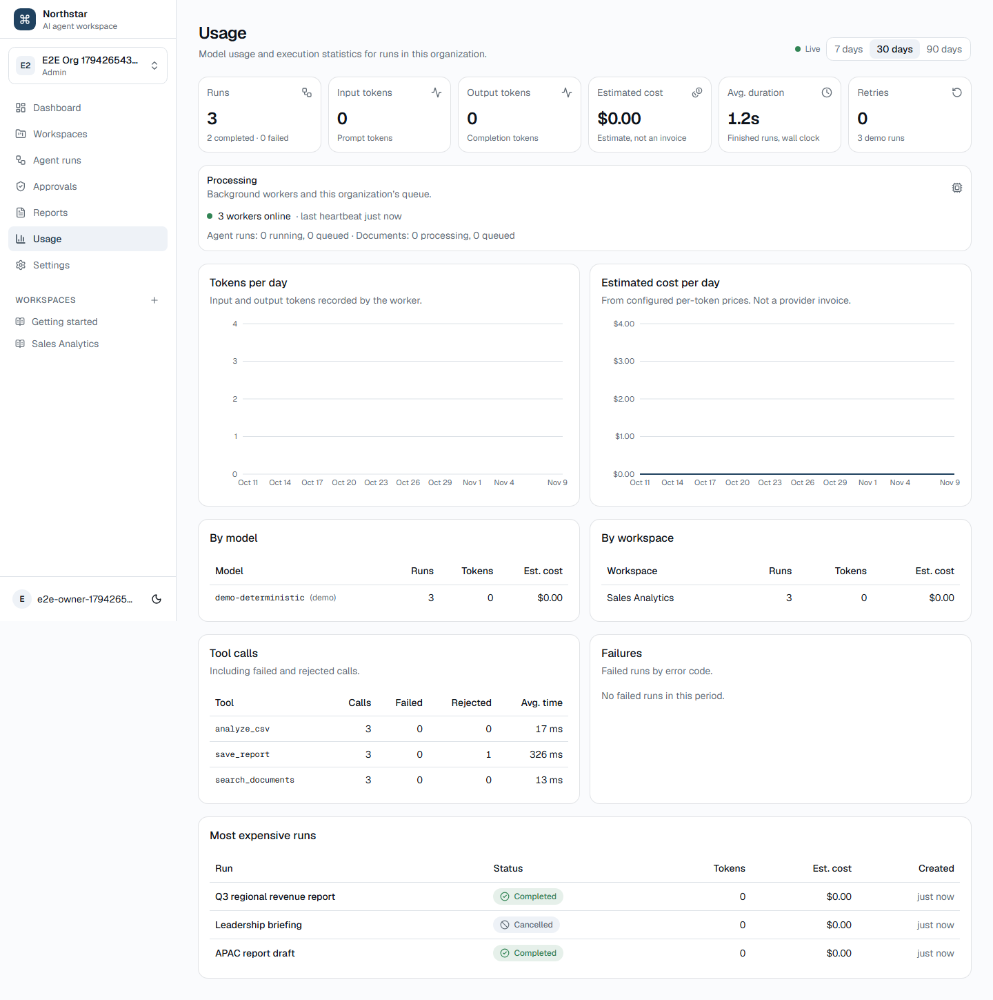 **Usage**: tokens, estimated cost, tool and failure statistics | 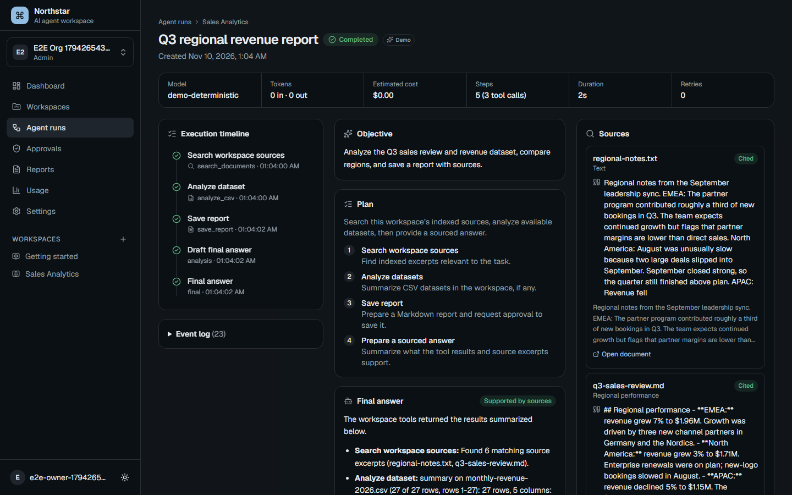 **Dark theme** |

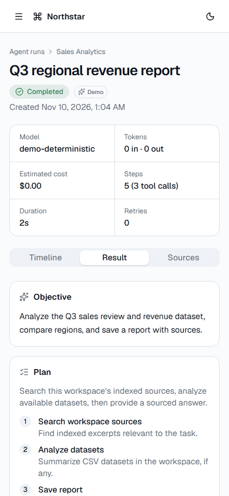

The screenshots are generated by the Playwright suite (`pnpm test:e2e`) against a real worker using the demo provider. That is why token counts and costs are zero.

## Technology stack

| Layer | Choices |
| --- | --- |
| Web | Next.js 16 (App Router, Cache Components), React 19, TypeScript (strict), Tailwind CSS 4, shadcn/ui (Base UI), TanStack Query, React Hook Form, Zod, Recharts, Lucide, react-markdown |
| API | Next.js Route Handlers with a shared auth/validation wrapper |
| Worker | Node.js 22, TypeScript via tsx, postgres.js, Supabase JS (Storage), OpenAI SDK (Responses API, structured outputs), pdf-parse, mammoth, csv-parse |
| Data | Supabase Postgres with RLS, pgvector (HNSW), Supabase Auth, private Storage, Realtime; a Postgres-backed job queue |
| Tests | Vitest (unit and integration), pgTAP (`supabase test db`), Playwright (end-to-end) |
| Tooling | pnpm workspaces, ESLint, GitHub Actions, Docker (worker image) |

## Architecture

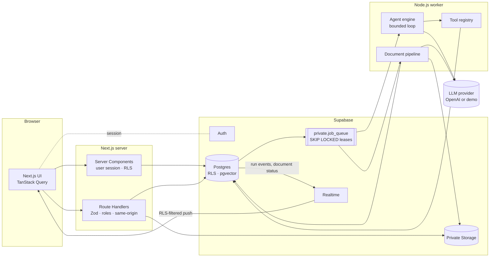

```text
apps/
  web/       Next.js app: pages, Route Handlers, features/* (queries, view models), components/*
  worker/    Agent engine, providers, tools, document pipeline, queue access, observability, demo seed
packages/
  shared/    Types and constants shared by web and worker (roles, statuses, event types)
supabase/
  migrations/   Schema, RLS, SQL functions, realtime publication
  tests/        pgTAP tests (tenant isolation, approvals, engine, security, observability)
tests/
  e2e/          Playwright specs
  fixtures/     Demo documents and dataset
scripts/        seed-demo-data.ts entry point
```

Responsibilities are split cleanly:

- The browser never talks to the LLM.
- HTTP requests never run agents.
- Only the worker writes execution state.
- Every read made by a user goes through RLS.

## Agent execution lifecycle

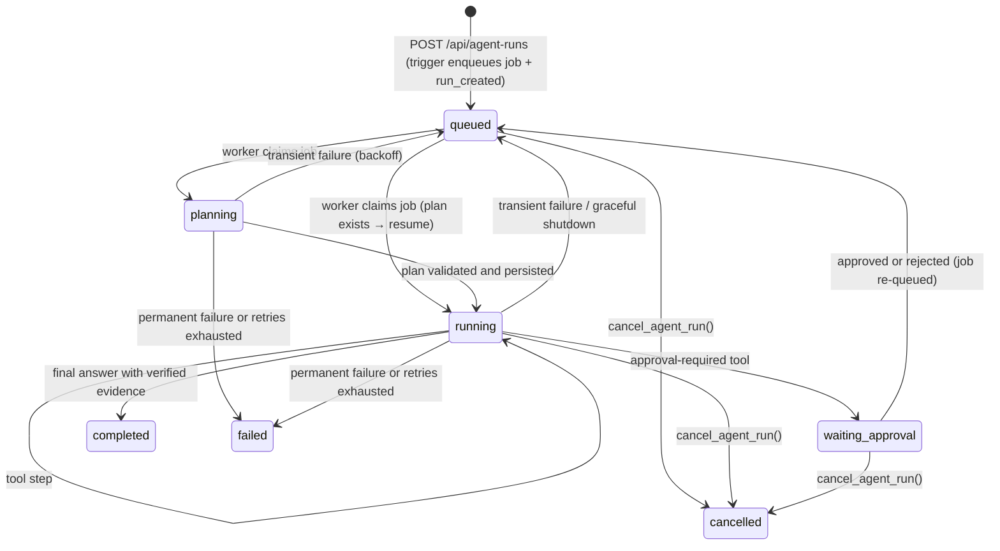

1. `claim_agent_jobs` leases one job atomically (`FOR UPDATE SKIP LOCKED`, 2-minute lease, attempt counter). The worker renews the lease every 30 s.
2. The worker re-reads the run creator's role, closes any step a crashed attempt left `running`, and rebuilds state from persisted steps: plan, evidence, CSV data references, tool steps used, draft, and approved or rejected actions. A resumed run never re-plans or repeats completed tool calls.
3. A fresh run gets a structured plan from the provider. It is validated with Zod and stored as a `planning` step.
4. Each iteration asks the provider for exactly one action: `tool_call`, `approval_request`, or `final_answer`. The tool name must be registered. Arguments are a JSON string validated by that tool's schema. The organization and workspace scope comes from the run record, never from model output.
5. Every step emits ordered events: `step_started → tool_call_started → tool_call_completed → step_completed`, or `step_failed`.
6. The final answer is citation-checked (see [Evidence](#evidence-and-citations)). `run_completed` and the job completion are written in one transaction.

| Limit | Variable | Behaviour |
| --- | --- | --- |
| Tool steps | `MAX_AGENT_STEPS` (8) | Counts every attempted tool call across retries, including failed and rejected ones. Exceeding it fails with `step_limit_exceeded` and is not retried. |
| Duration | `MAX_AGENT_DURATION_MS` | Per attempt; `duration_limit_exceeded`. |
| Estimated cost | `MAX_AGENT_COST_USD` | Checked before each call with a worst-case reserve, and after each call with reported usage. |
| Tokens | `MAX_INPUT_TOKENS`, `MAX_OUTPUT_TOKENS` | Oversized prompts are rejected before sending; truncated responses fail with `token_limit_exceeded`. |
| Retries | `MAX_AGENT_RETRIES` (3) | Transient errors retry with exponential backoff (15 s, 30 s, 60 s…): rate limits, timeouts, provider 5xx, database connectivity, invalid model output, tool crashes. Credential, quota, permission, and limit errors fail immediately. |

Failures are stored as a stable `error_code` with a user-safe message. Raw provider or database errors appear only, truncated, in worker logs. No hidden model reasoning is requested, stored, or shown: users see the plan, tool calls, tool outputs, and evidence.

**Cancellation and crashes**

- `cancel_agent_run()` checks the caller's role and atomically updates the run, job, and open steps, emits `run_cancelled`, and writes an audit entry. The worker notices at its next checkpoint or heartbeat and aborts in-flight provider requests.
- If a worker crashes, the lease expires and another worker reclaims the job as a new attempt. If the crash happens on the final attempt, the run fails with `worker_lease_exhausted`.
- On SIGTERM, the worker stops polling, stops runs at the next checkpoint, and releases their jobs without consuming an attempt.

## Tool registry

Tools are defined with `defineTool()` (`apps/worker/src/tools/`). Each definition declares:

| Field | Purpose |
| --- | --- |
| `name`, `title`, `description` | Stable identifier, step title shown to users, description for the model |
| `inputSchema`, `outputSchema` | Zod schemas. Inputs are validated before execution and again after resume. Outputs are validated before they are stored. The input JSON schema is sent to the provider. |
| `allowedRoles` | Roles the run creator must hold, re-checked on every attempt |
| `requiresApproval`, `describeApproval()` | The registry, not the model, decides whether approval is required |
| `execute(input, context)` | Runs with the run's scope, an abort signal, the evidence so far, and the selected-document scope |
| `summarize()`, `evidenceFrom()`, `dataReferencesFrom()` | A concise result for the model, citation evidence, and CSV row references. Also used to rebuild state. |

| Tool | Behaviour | Safety |
| --- | --- | --- |
| `search_documents` | pgvector similarity search (keyword fallback without embeddings), optional document filter | Workspace scope comes from the run. The task's selected documents always apply. |
| `analyze_csv` | `summary`, `missing_values`, `aggregation`, `group_by`, `trend` (as-is, month, quarter, year), `top_n`, with filters | Predefined operations in TypeScript; no SQL or code from the model; at most 50,000 rows; results include row ranges |
| `calculate` | Expressions, descriptive statistics, percent change | Own recursive-descent parser with a fixed grammar; no `eval`; length and depth limits; finite results only |
| `save_report` | Saves a Markdown report as an artifact | Requires approval. It may cite only chunks retrieved in this run. Execution re-checks that the sources still exist and is idempotent per step. |

Errors the model can fix are recorded as failed steps and returned to the model: an unknown tool, malformed JSON, a schema violation, an unknown CSV column, division by zero. They count toward the step limit.

## Human-in-the-loop approval

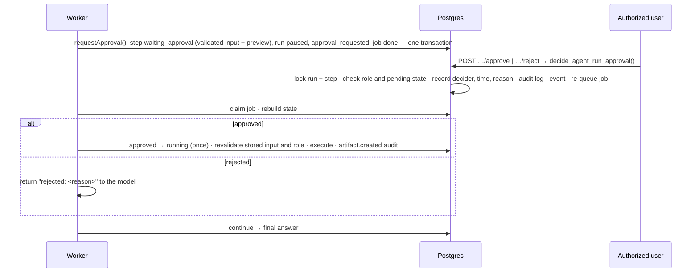

- **Approval request contents.** The action, the report title, a Markdown preview, the cited excerpts, CSV data references, and the expected effect.
- **Who can decide.** Organization admins, or the member who created the run. Viewers and other organizations get `42501`. A second decision fails with `55000`.
- **What gets executed.** Only the stored, revalidated action is executed, never anything from the client.
- **Crashes during execution.** If the worker crashes while executing an approved action, the step returns to `approved`. The unique `artifacts.source_step_id` makes the report idempotent.
- **Provenance.** Only the worker can set `source_step_id` (a trigger guard), so users cannot forge agent provenance. The UI derives "created by an agent run" from that column, not from editable metadata.

## Evidence and citations

- Retrieved chunks keep their source location: page, section heading, or CSV row range.
- A citation from the model is accepted only if it:
  1. references a chunk retrieved in the same run;
  2. quotes that chunk verbatim.

  The snippet shown to users comes from stored text, never from model output.
- An answer counts as supported if it has at least one verified citation or is based on CSV analysis. Otherwise it is replaced by "I could not verify a supported answer from the indexed sources".
- Users can open the original document from any source through a 60-second signed URL.
- Uploaded content is untrusted. It is passed to the model inside `<untrusted_evidence>` with instructions to ignore any instructions it contains. Tool scope and permissions are enforced in code regardless of what the model asks for.

## Data model

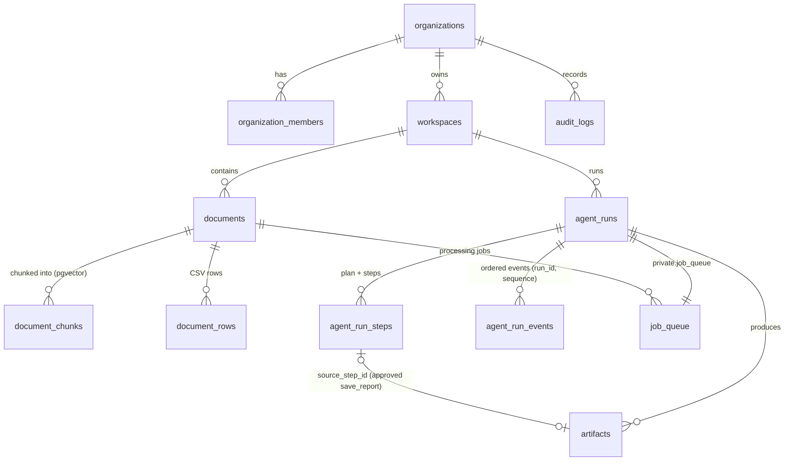

- Tenant-owned rows carry both `organization_id` and `workspace_id`, and composite foreign keys (`(id, organization_id, workspace_id)`) make cross-tenant references impossible.
- `agent_runs.context` stores the documents selected for a task; this column is an addition to the original specification.
- Indexes follow the query patterns: tenant plus `created_at` lists, statuses, run steps and events by run, pending approvals, the HNSW vector index, the queue claim order, and expired leases.

## Security model

- **Authentication.** Supabase Auth with SSR cookies. `proxy.ts` refreshes sessions and protects every page. API handlers verify the user on each request.
- **Authorization in the database.** RLS is enabled on every tenant table:

  | Data | Who can read it |
  | --- | --- |
  | Organization data | Members of that organization |
  | Runs, steps, events | Admins: all; members: their own; viewers: completed runs |
  | Audit logs | Admins only |

  - Cancellation and approval decisions are possible only through `SECURITY DEFINER` functions with a fixed `search_path` and explicit checks. Direct updates of runs and steps are revoked for API roles.
  - `TRUNCATE`, `TRIGGER`, and `REFERENCES` are revoked from API roles. Supabase grants them by default, and `TRUNCATE` bypasses RLS.
  - Client inserts cannot set worker-owned columns (status, model, tokens, cost, retries, errors, document processing state). A `BEFORE INSERT` trigger resets them.
  - A document's `storage_path` must sit under its own organization, workspace, and document ID. Without this, a member could insert a row pointing at another tenant's file and have the worker index it.
- **Authorization in the API.** Roles are checked before mutations, the organization is derived from the workspace (never taken from the client), every input is validated with Zod, and errors are mapped to safe messages. Mutations with a foreign `Origin` header are rejected.
- **Uploads.** Extension and size are checked, the content must match its type, file names are sanitized, files go to a private bucket with Storage RLS by path, and downloads use short-lived signed URLs.
- **Secrets.** The service role key, database URL, and LLM key exist only in the server and worker environments. The settings page shows non-secret configuration only.
- **Headers.** `X-Frame-Options: DENY`, `frame-ancestors 'none'`, `nosniff`, a strict referrer policy, and a restrictive permissions policy.
- **Verification.** 108 pgTAP assertions cover tenant isolation, approvals, cancellation, privileges, and spoofing attempts. The Playwright suite checks that another organization gets "not found" for runs and workspaces, and 404 or an empty list from the API.

## Background worker

`apps/worker` runs two independent poll loops, documents and agent runs, so a long run never blocks indexing.

- **Queue.** Jobs live in `private.job_queue`. Claims use `FOR UPDATE SKIP LOCKED` with leases, heartbeats, reclaiming of expired leases, a maximum number of attempts, and exponential backoff.
- **Providers.** `LLMProvider` is provider-neutral. `OpenAIProvider` uses the Responses API with strict structured outputs, validates the result again with Zod, and maps SDK errors to stable codes. `DemoProvider` is deterministic and labels runs `demo-deterministic`.
- **Outcomes.** Each job ends with an explicit outcome: `completed`, `paused_for_approval`, `retrying`, `failed`, `cancelled`, `released`, `lease_lost`, or `skipped`.
- **Shutdown.** On SIGINT or SIGTERM, in-flight runs are released and the worker's heartbeat row is removed.

## Document ingestion

1. `POST /api/documents/upload` validates the file, writes it to `workspace-documents/{org}/{workspace}/{document}/{name}`, and inserts the row. A trigger queues a processing job.
2. The worker claims the job and downloads the file with the service role.
3. Extraction by type:
   - **PDF:** text per page.
   - **DOCX:** sections by heading.
   - **Markdown:** sections by heading.
   - **TXT:** the whole text.
   - **CSV:** parsed rows stored in `document_rows` with their indexes, plus row-level chunks.
   Text is capped at 5 million characters.
4. Chunking uses about 1,200 characters with 180 characters of overlap. Every chunk keeps its source location.
5. Embeddings are generated in batches of 64 when an embedding key is configured (`text-embedding-3-small`, 1536 dimensions, validated at startup).
6. Chunks and rows are replaced in one transaction, and the document becomes `indexed`. Failures are retried with backoff and shown with a retry button.
7. Duplicate uploads are rejected by a per-workspace SHA-256 checksum.

## Real-time updates

- **What is published.** `agent_run_events` and `documents` are in the `supabase_realtime` publication. Subscriptions use the user's token, so Supabase applies RLS to every change. A user from another organization receives nothing, even with a guessed filter; this was verified against the local stack.
- **The hook.** `useRealtimeTable` opens one narrowly filtered channel, reports `connecting`, `live`, `reconnecting`, or `offline`, resyncs on every (re)subscribe, and removes the channel on unmount.
- **Run page.**
  - Pushed events are merged by `sequence`, so duplicates and late events are harmless.
  - Steps and status are refetched with a 250 ms debounce.
  - A sequence gap triggers an immediate resync.
  - The channel closes when the run reaches a terminal state.
- **Missed-event safety.** Postgres Changes can take a few seconds to start delivering after `SUBSCRIBED`; this was observed locally. The hook therefore resyncs again after 3 s. Run pages also resync every 30 s while live, because a missed *final* event has no later event to reveal the gap. While the channel is down, the page polls every 10 s.
- **Other pages.** The knowledge base updates document status by push. The dashboard, run lists, approvals, workspace pages, and usage page re-render on events, debounced by 1.5 s.

## Usage and observability

- **Usage page.** `/usage` shows runs, tokens, and estimated cost per day; breakdowns by model and workspace; tool calls with failures, rejections, and average latency; failures by error code; and the most expensive runs. The data comes from `usage_summary()`, which is `SECURITY INVOKER`, so it aggregates only rows the caller may read.
- **Estimated cost.** Costs come from `LLM_INPUT_COST_PER_MILLION` and `LLM_OUTPUT_COST_PER_MILLION` and are always labelled as estimates, not invoices.
- **Worker heartbeats.** Each worker writes a heartbeat every 15 s. `queue_status()` exposes only the organization's queue depth, the age of the oldest waiting job, and aggregate worker liveness.
- **Structured JSON logs.** Every line carries correlation IDs: `worker_id`, `job_id`, `run_id`, `document_id`, `attempt`. Logged events:
  - provider calls with latency, tokens, and cost;
  - run completion metrics;
  - failures with error codes;
  - document indexing time;
  - periodic worker counters.

  Secret-like fields are redacted. Prompts and document content are never logged.

## Local setup

Requirements: Node.js 22+, pnpm 12, Docker Desktop.

```bash
pnpm install
pnpm db:start                 # local Supabase (applies migrations)
pnpm db:status                # shows API URL, keys, and database URL
cp .env.example .env          # fill in values from db:status (worker + server)
# apps/web/.env.local: NEXT_PUBLIC_SUPABASE_URL and NEXT_PUBLIC_SUPABASE_ANON_KEY
pnpm seed:demo                # optional demo organization (see below)
pnpm dev                      # web app on http://localhost:3000
pnpm --filter @ai-agent/worker dev   # background worker (separate terminal)
```

Database helpers:

- `pnpm db:reset` reapplies migrations. It wipes local data.
- `pnpm db:types` regenerates `apps/web/src/lib/supabase/database.types.ts`.
- `pnpm db:test` runs the pgTAP tests.

## Configuration

All variables are listed in `.env.example`. The worker validates its environment with Zod at startup and exits on invalid configuration.

| Variable | Used by | Notes |
| --- | --- | --- |
| `NEXT_PUBLIC_SUPABASE_URL`, `NEXT_PUBLIC_SUPABASE_ANON_KEY` | web, worker | Public values |
| `SUPABASE_SERVICE_ROLE_KEY`, `SUPABASE_DB_URL` | worker | Secret; never sent to the browser |
| `LLM_PROVIDER` (`openai` or `demo`), `LLM_API_KEY`, `LLM_MODEL` | worker | Without a key, or with `demo`, the deterministic demo provider runs |
| `EMBEDDING_API_KEY`, `EMBEDDING_MODEL`, `EMBEDDING_DIMENSIONS` | worker | Dimensions must be 1536 (the vector column); without a key, search uses keywords |
| `WORKER_POLL_INTERVAL_MS`, `MAX_AGENT_STEPS`, `MAX_AGENT_DURATION_MS`, `MAX_AGENT_COST_USD`, `MAX_AGENT_RETRIES`, `MAX_INPUT_TOKENS`, `MAX_OUTPUT_TOKENS` | worker | Execution limits |
| `LLM_INPUT_COST_PER_MILLION`, `LLM_OUTPUT_COST_PER_MILLION` | worker | Pricing for cost estimates |
| `DEMO_MODE` | worker, web (display) | Demo labelling |

## Demo data

```bash
pnpm seed:demo            # creates "Northstar Demo" (skips if it exists)
pnpm seed:demo --reset    # recreates it
```

The seed runs the real pipeline rather than inserting a pretend history:

1. It uploads `tests/fixtures/demo/` (a Q3 sales review, regional notes, and a monthly revenue CSV) to Storage, and the document worker indexes them.
2. It creates five runs and executes them with the deterministic demo provider:
   - two completed (one with an approved report);
   - one with a rejected report;
   - one waiting for approval;
   - one cancelled.
3. It decides approvals through `decide_agent_run_approval()`.

Seeded runs have a **Seeded demo** badge, and demo-provider output has a **Demo** badge and notice. Sign in as `demo@northstar.dev` / `northstar-demo-2026` (override with `DEMO_USER_EMAIL` and `DEMO_USER_PASSWORD`).

## Testing

| Command | What it covers |
| --- | --- |
| `pnpm test` | Worker and web unit tests (Vitest) plus database tests (pgTAP) |
| `pnpm test:integration` | Worker against local Supabase. **Do not run a separate worker at the same time.** |
| `pnpm test:e2e` | Playwright against the built app and a real worker. Run `pnpm build` first; Supabase must be running. Each run creates uniquely named test users (`pnpm db:reset` clears them). |
| `pnpm typecheck`, `pnpm lint`, `pnpm build` | Static checks and production build |

**Unit tests**:

- Zod schemas and tool input validation.
- The calculator parser, including code-injection attempts.
- CSV operations and their summaries.
- Tool permissions and the tool registry.
- Agent state transitions, resume, and approval handling.
- Retry policy, cost and limit calculations, and provider error mapping.
- Evidence and citation formatting.
- Run view models and event ordering and deduplication.
- Upload validation and the same-origin check.

**Integration tests**:

- Concurrent job claims and crash recovery through lease expiry.
- Transient retry with backoff, permission loss, and cancellation.
- The approval workflow with exactly-once artifacts and audit logs.
- Rejection.
- Document ingestion with source locations.
- Vector and keyword search isolation between organizations.

**Database tests**: tenant isolation, approvals, the engine queue, retrieval, observability, and security hardening.

**End-to-end tests** cover the 12 scenarios from the specification:

1. Sign-up.
2. Onboarding, then workspace creation.
3. Upload.
4. Live indexing.
5. Task creation with review.
6. The plan.
7. Document search.
8. Live progress.
9. The approval request.
10. Approval.
11. The report in artifacts.
12. Source inspection.

They also cover rejection, cancellation, cross-organization access, unauthenticated access, dark theme, and mobile layouts (no horizontal overflow).

## Deployment

1. **Supabase project.** Create a project, then run `supabase link --project-ref <ref>` and `supabase db push` to apply all migrations. The migrations create the private bucket, RLS, functions, and the realtime publication. Enable the `vector` extension if your plan requires it explicitly.
2. **Web app (for example Vercel).**
   - Set the root directory to `apps/web`.
   - Set the environment variables `NEXT_PUBLIC_SUPABASE_URL` and `NEXT_PUBLIC_SUPABASE_ANON_KEY`, plus optional display-only `LLM_MODEL` and `DEMO_MODE`.
   - Add the site URL to Supabase Auth's allowed redirect URLs.
3. **Worker (any container host: Fly.io, Render, Railway, ECS).**
   - Build it with `docker build -f apps/worker/Dockerfile -t northstar-worker .`.
   - Provide the worker variables from `.env.example`. Use the pooled database URL in session mode.
   - Run one or more replicas. Leases make horizontal scaling safe.
   - Send SIGTERM for graceful shutdown.
4. **Demo deployment.** Leave `LLM_API_KEY` empty (or set `LLM_PROVIDER=demo`), then run `pnpm seed:demo` once with the production environment.
5. **CI.** `.github/workflows/ci.yml` runs typecheck, lint, unit tests, and the build. It then starts Supabase to run pgTAP, integration, and Playwright tests.

## API

Responses use `{ data, meta? }` or `{ error: { code, message, details? } }`. All routes require a session, validate input with Zod, and rely on RLS.

| Method | Route | Notes |
| --- | --- | --- |
| GET, POST | `/api/organizations` | List memberships; create an organization with its first workspace (the creator becomes admin) |
| GET, POST | `/api/workspaces` | Paginated list; admins create |
| GET, PATCH, DELETE | `/api/workspaces/[id]` | Counts; admins update or delete (stored files are removed) |
| GET | `/api/documents?workspaceId&q&status&page` | Paginated |
| POST | `/api/documents/upload` | Multipart `workspaceId` + `file`; 409 for duplicates |
| GET, DELETE | `/api/documents/[id]` | Details, chunk and row counts, a 60 s signed URL; admins delete |
| POST | `/api/documents/[id]/retry` | Re-queue a failed document |
| GET, POST | `/api/agent-runs` | Paginated list; create `{ workspaceId, title, objective, documentIds? }` (202) |
| GET | `/api/agent-runs/[id]` | Run with ordered steps and events |
| POST | `/api/agent-runs/[id]/cancel` | 409 if the run is no longer active |
| POST | `/api/agent-runs/[id]/steps/[stepId]/approve` and `/reject` | Optional `{ reason }`; 403 if not allowed, 409 if already decided |
| GET, POST | `/api/artifacts` | Search and filters; user-authored artifacts |
| GET | `/api/artifacts/[id]` | JSON, or `?format=markdown` to download |

## Architecture decisions and trade-offs

| Decision | Why | Trade-off |
| --- | --- | --- |
| Separate worker plus a Postgres queue | Runs outlive HTTP requests. Claims, leases, events, and approvals stay transactional with application data, with no extra infrastructure. | Lower throughput than a dedicated queue. Polling adds up to `WORKER_POLL_INTERVAL_MS` of latency. |
| RLS as the final boundary, plus API checks | A bug in one layer does not leak data. Server Components can query directly as the user. | More SQL to maintain. Policies need their own tests (pgTAP). |
| State is rebuilt from persisted steps | Retries and crashes resume without re-planning, repeating tools, or exceeding limits. | Steps must contain everything needed to resume, so tool outputs are stored, bounded in size. |
| Flat structured action with `arguments_json` | Works with strict structured-output modes for any number of tools; each tool validates its own schema. | One extra JSON parse; invalid arguments cost a step. |
| The registry decides approval | The model cannot skip approval by choosing a different action type. | Approval policy is per tool, not per argument. |
| CSV analysis in TypeScript over stored rows | No model-generated SQL or code; operations are predictable and testable. | Limited to 50,000 rows per call and to predefined operations. |
| Strict citation verification | Fabricated or paraphrased citations are dropped automatically. | A correct answer with a sloppy quote becomes "could not verify". |
| Realtime events plus API resync | Instant updates while staying correct when events are missed. | More moving parts than polling: subscription, gap detection, safety resync. |
| Demo provider plus a seed through the real pipeline | The app can be explored for free, and the demo output is honest. | The demo provider follows a fixed policy and does not show model reasoning quality. |

## Known limitations

- **Organization management.** There are no member invitations, role management screens, or organization renaming. The settings page is read-only.
- **Approvals.** A member can decide only on runs they created; there is no separate approver role.
- **Realtime.** Delivery is not guaranteed. The UI compensates by resyncing, so a lost *final* event can delay a run page by up to 30 s.
- **Status codes of pages.** Pages stream, so "not found" pages (including access denied) render with HTTP 200 after the shell has been sent. The API returns proper 401, 403, and 404 codes.
- **Limits and estimates.**
  - The duration limit applies per attempt.
  - Token estimates use about 4 characters per token before sending; the provider's reported usage is what gets recorded.
  - `analyze_csv` holds up to 50,000 rows in worker memory.
  - Dashboard totals use the 1,000 most recent visible runs, and `usage_summary` aggregates on demand. Large organizations would need daily rollups.
- **Monitoring.** There is no Prometheus/OpenTelemetry exporter or alerting; metrics live in logs and heartbeats.
- **Storage cleanup.** Deleting an organization directly in SQL leaves its files in Storage. The API delete endpoints remove them.
- **Formats.** Scanned PDFs have no OCR. Only one real LLM provider (OpenAI) is implemented.
- **Rate limiting.** There is no request rate limiting in the API.
- **Verification gaps.**
  - The OpenAI provider is covered by unit tests with mocked SDK errors but was not exercised against the live API during development.
  - The CI workflow was written but has not been run on GitHub yet.
